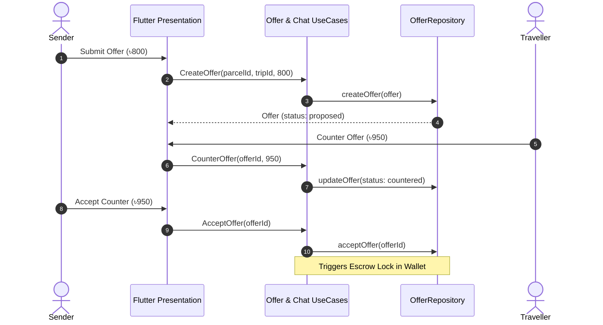
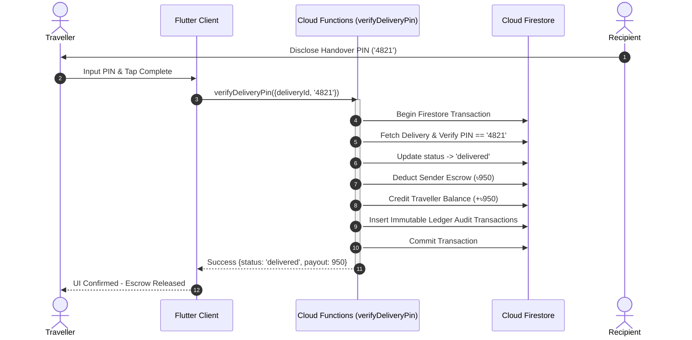

# Software Design Document (SDD)
## CorridorShare — System Architecture and Detailed Design

**Standard**: IEEE Std 1016-2009  
**Subproject**: `corridorshare/`  
**Team**: Fahmid Hasan Taohid, JFJubayer, Fahim Abir  
**Course**: CSE-3102 Software Engineering  
**Version**: 1.0.0  
**Date**: 2026-10-13  

---

### 1. Architectural Overview

CorridorShare implements Uncle Bob's **Clean Architecture** combined with **Riverpod 2.x** reactive state management. The system is partitioned into vertical feature slices and horizontal architectural layers to maximize decoupling, testability, and adherence to the Dependency Inversion Principle.

```mermaid
graph TD
    subgraph Presentation_Layer [Presentation Layer]
        UI[Flutter Widgets & Pages]
        Controllers[StateNotifier & AsyncNotifier Controllers]
    end

    subgraph Domain_Layer [Domain Layer (Pure Dart)]
        Entities[Entities & Value Objects]
        UseCases[Use Cases / Interactors]
        RepoInterfaces[Repository Interfaces]
    end

    subgraph Composition_Root [Core DI Composition Root]
        DI[core/di/injection.dart]
    end

    subgraph Data_Layer [Data Layer]
        RepoImpl[Repository Implementations]
        DataSources[In-Memory & Firebase Remote DataSources]
        DTOs[Data Transfer Objects & Mappers]
    end

    subgraph Cloud_Backend [Firebase Serverless Backend]
        CloudFunctions[TypeScript Cloud Functions]
        Firestore[(Firestore Documents)]
        Storage[(Cloud Storage Buckets)]
    end

    UI --> Controllers
    Controllers --> UseCases
    UseCases --> RepoInterfaces
    UseCases --> Entities
    DI --> RepoImpl
    DI --> DataSources
    RepoImpl --> RepoInterfaces
    RepoImpl --> DataSources
    DataSources --> CloudFunctions
    CloudFunctions --> Firestore
    CloudFunctions --> Storage
```

---

### 2. Layer Decoupling and Composition Root

To strictly preserve layer boundaries and resolve Clean Architecture violations:
1. **Presentation Layer**: Imports only `features/*/domain` and `core/di/injection.dart`. Direct references to concrete `data/datasources` and `data/repositories/*_impl.dart` are prohibited.
2. **Domain Layer**: Contains pure Dart code with 0 dependencies on `flutter/` or `firebase_core/`.
3. **Data Layer**: Implements domain repository interfaces and orchestrates local memory caches and remote Firebase APIs.
4. **Composition Root (`lib/core/di/injection.dart`)**: Single point of assembly defining Riverpod providers for all datasources and repositories.

---

### 3. Sequence Diagrams

#### 3.1 Offer Negotiation Sequence



#### 3.2 Handover and 4-Digit PIN Settlement Sequence



---

### 4. Data Design & Entity Schemas

#### 4.1 Core Entity Transition State Machines

| State Machine | Initial State | Intermediate States | Terminal States |
|:---|:---|:---|:---|
| **TripStatus** | `open` | `full` | `completed`, `cancelled` |
| **ParcelStatus** | `open` | `matched`, `inTransit`, `disputed` | `delivered`, `cancelled` |
| **OfferStatus** | `proposed` | `countered` | `accepted`, `rejected`, `cancelled` |
| **DeliveryStatus** | `matched` | `inTransit`, `disputed` | `delivered`, `cancelled` |

---

### 5. Security & Access Control Design

- **Participant-Only Scoping**: Firestore and Storage rules restrict delivery records, chat streams, and pickup condition photos exclusively to authenticated handover participants and system administrators.
- **Server-Authoritative Ledger**: Client applications cannot directly write balance documents in `/users/{userId}/wallet/**`. All modifications are executed via Cloud Functions under atomic ACID transactions.
