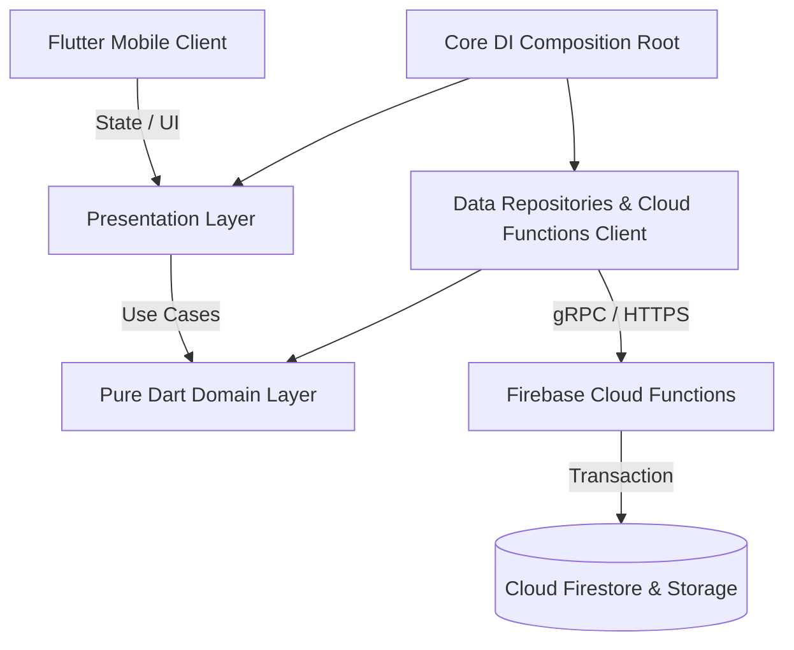

# Software Requirements Specification (SRS)
## CorridorShare — Peer-to-Peer Intercity Crowd-Shipping Platform for Bangladesh

**Standard**: IEEE Std 830-1998  
**Subproject**: `corridorshare/`  
**Team**: Fahmid Hasan Taohid, JFJubayer, Fahim Abir  
**Course**: CSE-3102 Software Engineering  
**Version**: 1.0.0  
**Date**: 2026-10-13  

---

### 1. Introduction

#### 1.1 Purpose
This document specifies the software requirements for **CorridorShare**, a peer-to-peer (P2P) crowdsourced delivery system tailored to Bangladesh's domestic transportation corridors (e.g., Dhaka–Chattogram, Dhaka–Sylhet, Dhaka–Rajshahi). It serves as the formal specification contract between system designers, developers, evaluators, and stakeholders.

#### 1.2 Scope
CorridorShare connects intercity travellers with unused luggage capacity to individuals needing express parcel delivery. The application enforces Bangladeshi regulatory compliance, prohibited contraband filtering, a two-party cryptographic/4-digit PIN handover protocol, simulated demo wallet escrow management, real-time negotiation, and dispute oversight.

#### 1.3 Definitions, Acronyms, and Abbreviations
- **P2P**: Peer-to-Peer.
- **Corridor**: Defined origin and destination administrative districts connected by major national transit networks.
- **PIN**: Personal Identification Number (4-digit numeric handover token).
- **Escrow**: Temporary holding of delivery rewards until authenticated recipient receipt.
- **No-Carry Tags**: Restrictions declared by travellers specifying classes of goods they refuse to transport.

#### 1.4 References
- IEEE Std 830-1998: Recommended Practice for Software Requirements Specifications.
- Post Office Act, 1898 & Bangladesh Telecommunication Regulatory Commission guidelines.

---

### 2. Overall Description

#### 2.1 Product Perspective
CorridorShare is built using Flutter (Dart 3.x), utilizing Clean Architecture and Riverpod state management. Backend services run on Firebase Authentication, Cloud Firestore, Cloud Storage, and server-authoritative Firebase Cloud Functions for transaction settlement.

#### 2.2 User Classes and Characteristics
1. **Sender**: Peer creating parcel delivery requests, funding escrow, and sharing the delivery PIN with the intended recipient.
2. **Traveller**: Peer publishing spare luggage capacity on scheduled journeys, accepting or countering parcel delivery offers, and verifying handovers.
3. **Recipient**: Designated party receiving the parcel at destination and providing the 4-digit PIN.
4. **Admin**: Platform moderator overseeing system metrics, reviewing unbacked injections, and resolving escalated disputes.

#### 2.3 Operating Environment
- Client: Android 8.0+ / iOS 14.0+ (Flutter Linux/macOS/Windows desktop enabled for evaluators).
- Backend: Firebase Serverless (Node.js 18+ Firebase Cloud Functions).

#### 2.4 Design and Implementation Constraints
- **Layer Isolation**: The domain layer (`lib/features/*/domain`) MUST contain zero Flutter or Firebase dependencies.
- **Authoritative Balance Execution**: Client Flutter runtimes are strictly untrusted; balance and escrow mutations execute via Cloud Functions.
- **Bilingual Interface**: All UI text must be externalized into ARB files (`app_en.arb` and `app_bn.arb`).

---

### 3. Specific Functional Requirements (FR1 – FR17)

| Identifier | Requirement Title | Description | Verification Method |
|:---|:---|:---|:---:|
| **FR1** | Phone Authentication & OTP | Authenticates users using BD mobile numbers (`01XXXXXXXXX`) and 6-digit verification codes. | Automated Test & Emulator |
| **FR2** | National Identity (NID) Upload | Users upload identity photos with `< 5MB` size constraints stored under restricted paths. | Storage Rules & Unit Test |
| **FR3** | User Profile & Reputation Summary | Displays peer ratings, completed trips, and trust badges. | Widget Test |
| **FR4** | Post Travel Trip | Travellers publish origin, destination, departure date, capacity (kg), and no-carry tags. | Unit Test & Widget Test |
| **FR5** | Trip Status State Machine | Enforces transitions: `open -> full / completed / cancelled`. Skipped transitions rejected. | Basis Path Unit Test |
| **FR6** | Post Parcel with Contraband Declaration | Senders publish parcel details with mandatory prohibited items legal declaration checkbox. | Validation Unit Test |
| **FR7** | Parcel Status State Machine | Enforces transitions: `open -> matched -> inTransit -> delivered / disputed / cancelled`. | 10 Basis Path Tests |
| **FR8** | Dual-Feed Browsing | Home screen renders dual toggle tabs for available trips and parcels with district filtering. | Widget Test |
| **FR9** | Corridor Matching Engine | Filters compatible parcels based on matching route, departure date $\le$ deadline, and capacity. | Unit Test |
| **FR10** | Traveller No-Carry Restrictions | Flags potential matches if parcel category tags collide with traveller no-carry restriction tags. | Substring & Exact Match Test |
| **FR11** | Negotiation Engine | Supports counter-offer cycles: `proposed -> countered -> accepted / rejected / cancelled`. | State Machine Test |
| **FR12** | Real-time Offer-Linked Chat | Live message stream anchored to active offer IDs with timestamped delivery. | Stream Provider Test |
| **FR13** | Handover Photo Proof | Travellers upload condition inspection photos before initiating transit. | Widget & Unit Test |
| **FR14** | Two-Factor Handover PIN | Handover completion requires entering matching 4-digit recipient PIN verified server-side. | Cloud Function Unit Test |
| **FR15** | Delivery Timeline & Disputes | Visual status stepper tracking delivery milestones with dispute escalation workflow. | Widget Test |
| **FR16** | Demo Wallet & Escrow | Escrow lock upon offer acceptance, release upon PIN verification, refund on dispute resolution. | Firestore Transaction Test |
| **FR17** | Peer Ratings & Reviews | Counterparts submit 1–5 star ratings and textual reviews calculating cumulative peer score. | Unit & Widget Test |

---

### 4. Non-Functional Requirements (NFR)

#### 4.1 Security & Backend Trust
- **NFR-SEC-1**: Cloud Firestore security rules reject direct writes to `/users/{userId}/wallet/**`.
- **NFR-SEC-2**: Verification PINs are stored securely and evaluated server-side in Cloud Functions.
- **NFR-SEC-3**: Handover inspection photos are restricted to image MIME types `< 5MB`.

#### 4.2 Usability & Accessibility
- **NFR-USA-1**: Complete bilingual coverage (English and Bengali) across all screens.
- **NFR-USA-2**: Responsive design supporting standard mobile dimensions down to 360px viewport width.
- **NFR-USA-3**: High-contrast theme adhering to WCAG 2.1 AA guidelines.

#### 4.3 Maintainability & Clean Architecture
- **NFR-MNT-1**: Composition root in `core/di/` wires dependencies without Presentation referencing Data directly.
- **NFR-MNT-2**: Domain code coverage exceeds **85%**.
- **NFR-MNT-3**: Zero static analysis defects under strict Flutter analyzer rules.
